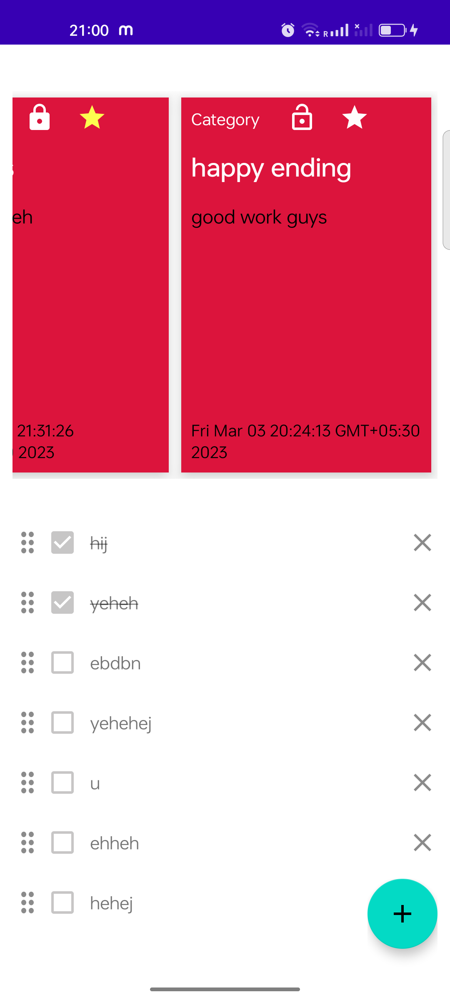
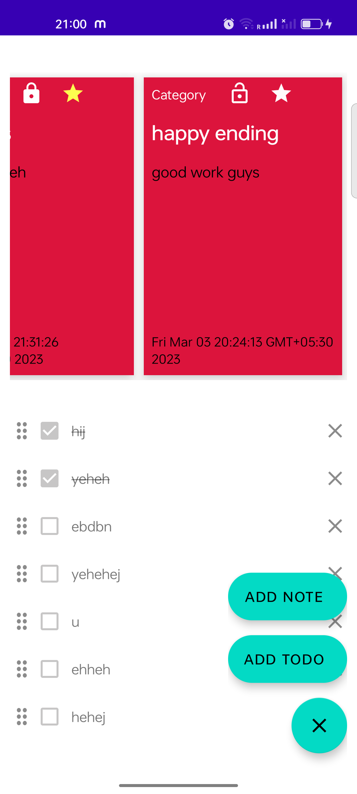
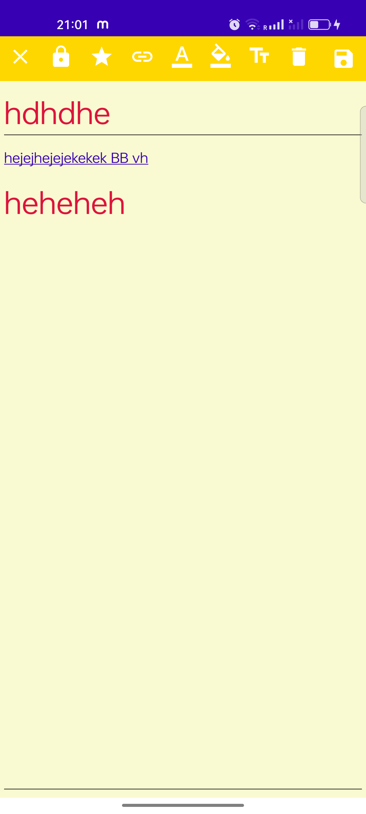
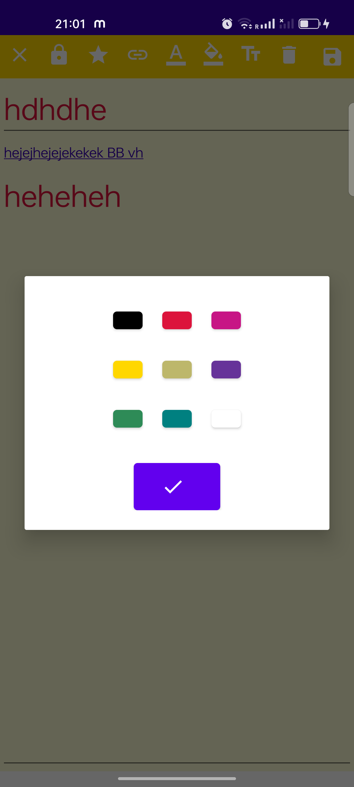
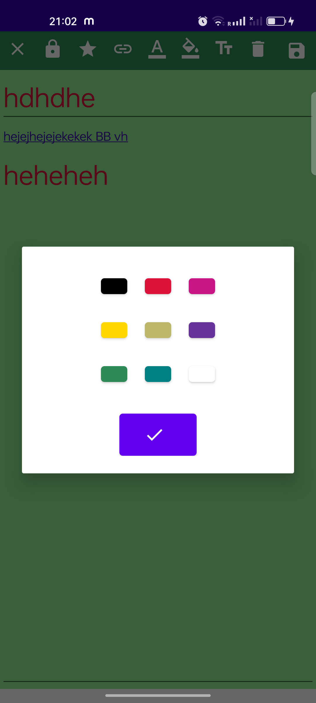
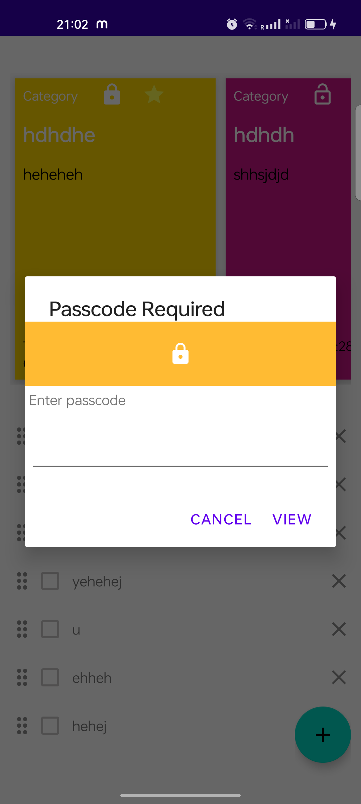
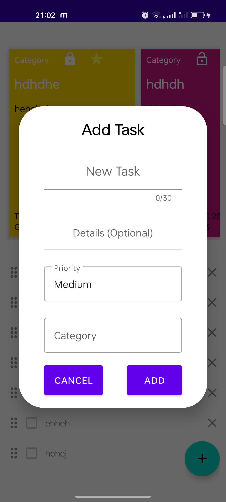
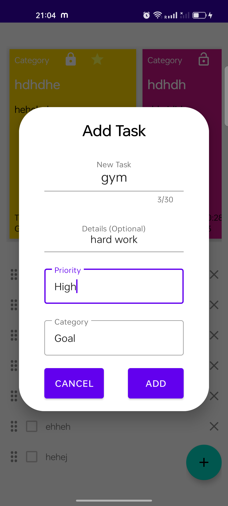

# Notes & To-Do

[](https://github.com/myofficework000/Notes-and-Todo-app/actions/workflows/main.yml)
[](https://kotlinlang.org/)
[](https://developer.android.com/)

A native Android notes and task manager focused on quick capture, simple organization, and distraction-free daily planning. The app is built with Kotlin, the AndroidX stack, Room persistence, Navigation, and View Binding.

## Highlights

- Create, edit, organize, complete, and delete to-do items.
- Capture rich notes with custom colors, text sizes, links, favorites, and optional locking.
- Keep data on-device with a Room-backed local database.
- Navigate cleanly between the dashboard, notes, and task details.
- Follow an MVVM-oriented structure with `ViewModel`, `LiveData`, coroutines, and DAOs.

## Tech stack

| Area | Technology |
| --- | --- |
| Language | Kotlin 2.4.21 |
| Build | Android Gradle Plugin 9.4.1 · Gradle 9.6 |
| UI | Android Views · View Binding · Material Components · ConstraintLayout |
| Architecture | ViewModel · LiveData · Navigation |
| Data | Room 2.8.5 · Kotlin Symbol Processing (KSP) |
| Async | Kotlin Coroutines 1.11.0 |
| Testing | JUnit · AndroidX Test · Espresso · MockK |

## Requirements

- Android Studio with JDK 17 or later
- Android SDK Platform 37
- A device or emulator running Android 7.0 (API 24) or newer

## Build and test

```bash
./gradlew assembleDebug
./gradlew test
```

The debug APK is generated at `app/build/outputs/apk/debug/app-debug.apk`.

## Screens

<p align="center">
  
  
  
  
</p>

<p align="center">
  
  
  
  
</p>

## Contributing

Issues and pull requests are welcome. Please open an issue before proposing large changes so the approach can be discussed first.

## Author

Built by [Abhishek Pathak](https://github.com/myofficework000). If this project is useful, a star helps others discover it.
